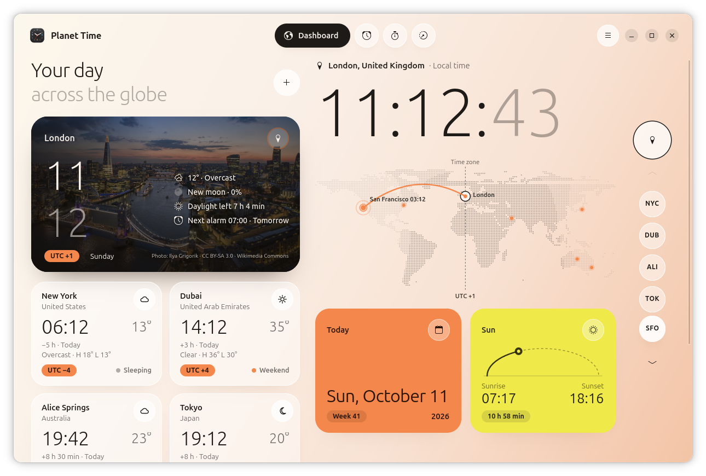
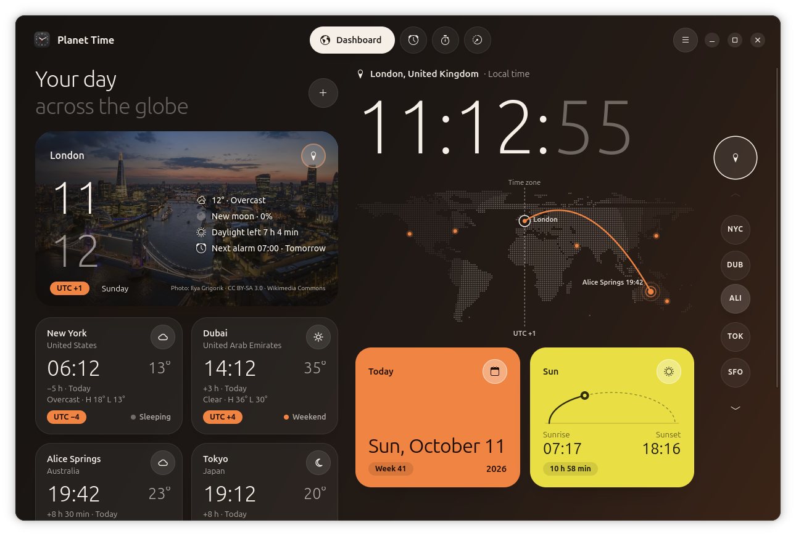
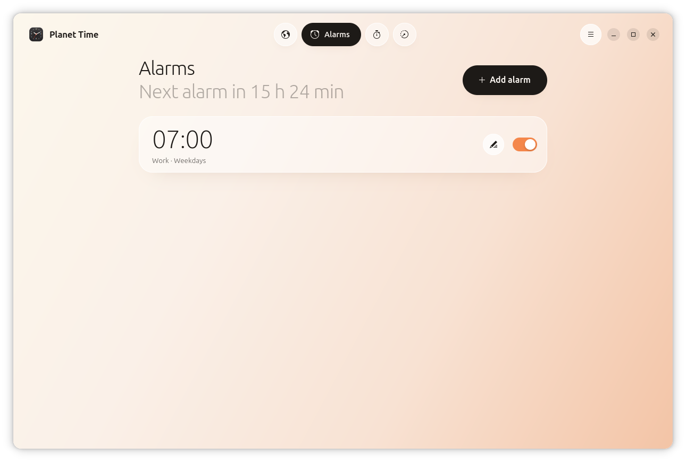
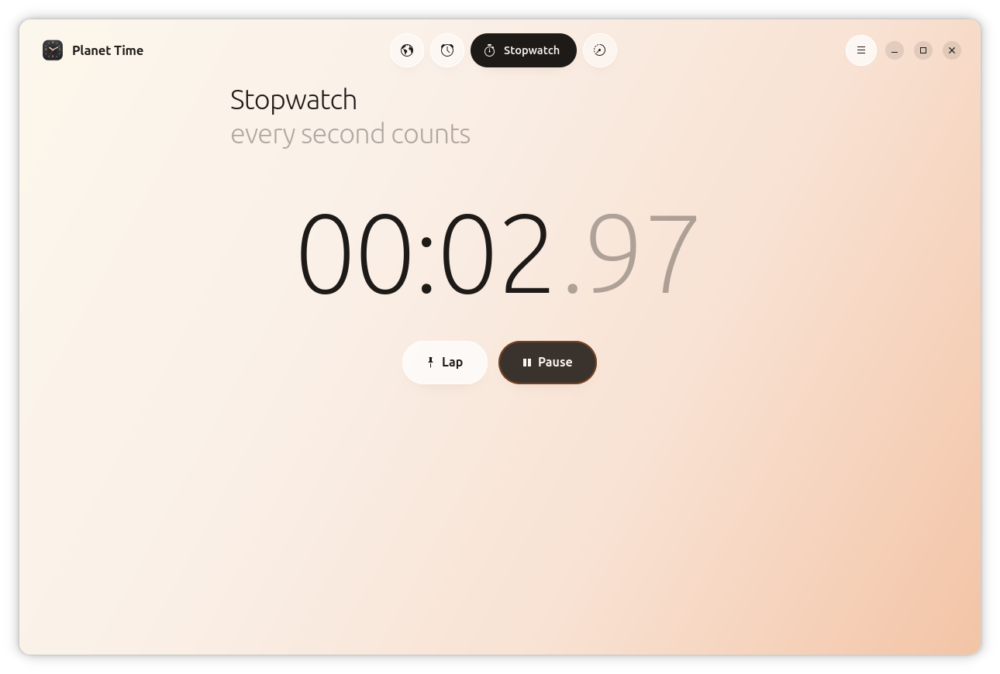
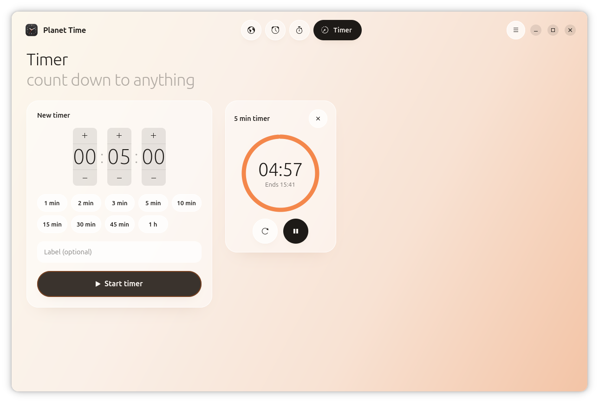

# Planet Time

A world clock dashboard for the GNOME desktop, with alarms, a stopwatch and timers. Built with Python, GTK 4 and libadwaita.



## Features

- **Dashboard**: world clocks on a dotted world map, sunrise and sunset times, and a home card with a living sky (or a photo of your city), weather, moon phase and your next alarm.
- **Weather**: current conditions for each city you add, from [Open-Meteo](https://open-meteo.com/).
- **Alarms**: repeating alarms that still ring when the window is closed.
- **Stopwatch** with laps, and **timers**.
- **Live dock icon**: an optional GNOME Shell extension draws the current time on the app icon in the dock, app grid and app switcher.

## Screenshots

Follows the system light and dark style:



| Alarms | Stopwatch | Timer |
|---|---|---|
|  |  |  |

## Requirements

- GNOME Shell 50 (for the dock icon extension; the app itself runs without it)
- Python 3 with PyGObject
- GTK 4, libadwaita 1, libgweather 4 and libsoup 3 introspection data

On Ubuntu:

```bash
sudo apt install python3-gi gir1.2-gtk-4.0 gir1.2-adw-1 gir1.2-gweather-4.0 gir1.2-soup-3.0 gir1.2-gstreamer-1.0
```

GStreamer is optional; it plays the alarm and timer sounds.

## Install

```bash
git clone https://github.com/pavistern/planet-time.git
cd planet-time
./install.sh
```

This installs for your user only, under `~/.local/share`. No root is needed.

To turn on the live dock icon, log out and back in (needed on Wayland), then run:

```bash
gnome-extensions enable live-clock-icon@local
```

To remove Planet Time:

```bash
./install.sh --uninstall
```

## Run without installing

```bash
python3 app/live_clock.py
```

## Privacy

- Weather comes from Open-Meteo. Home weather sends your home city's location, and city weather sends the locations of the cities you add. You can turn either one off in Preferences (Ctrl+,).
- The "City photo" background downloads your home city's photo from Wikipedia and caches it in `~/.cache/live-clock/`. The default "living sky" background makes no network requests.
- Settings and alarms are stored locally in `~/.config/live-clock/state.json`.

## Credits

- Map: land outline from [Natural Earth](https://www.naturalearthdata.com/) (public domain).
- City photos: from Wikipedia and Wikimedia Commons; each photo's author and license are shown on the home card.
- Weather: [Open-Meteo](https://open-meteo.com/).
- The snap package bundles alarm sounds from the [freedesktop sound theme](https://gitlab.freedesktop.org/xdg/xdg-sound-theme): "alarm-clock-elapsed" by Tim/corsica_s (CC BY-SA 3.0) and "complete" by Dr. Richard Boulanger et al. (CC BY 3.0).

## Project layout

```
app/          the application (live_clock.py launcher + liveclock package)
extension/    GNOME Shell extension for the live dock icon
data/         app icon and desktop launcher template
install.sh    per-user installer
docs/         screenshots
snap/         Snap package recipe (snapcraft.yaml)
```
